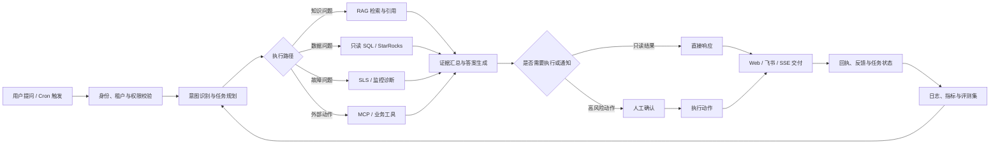
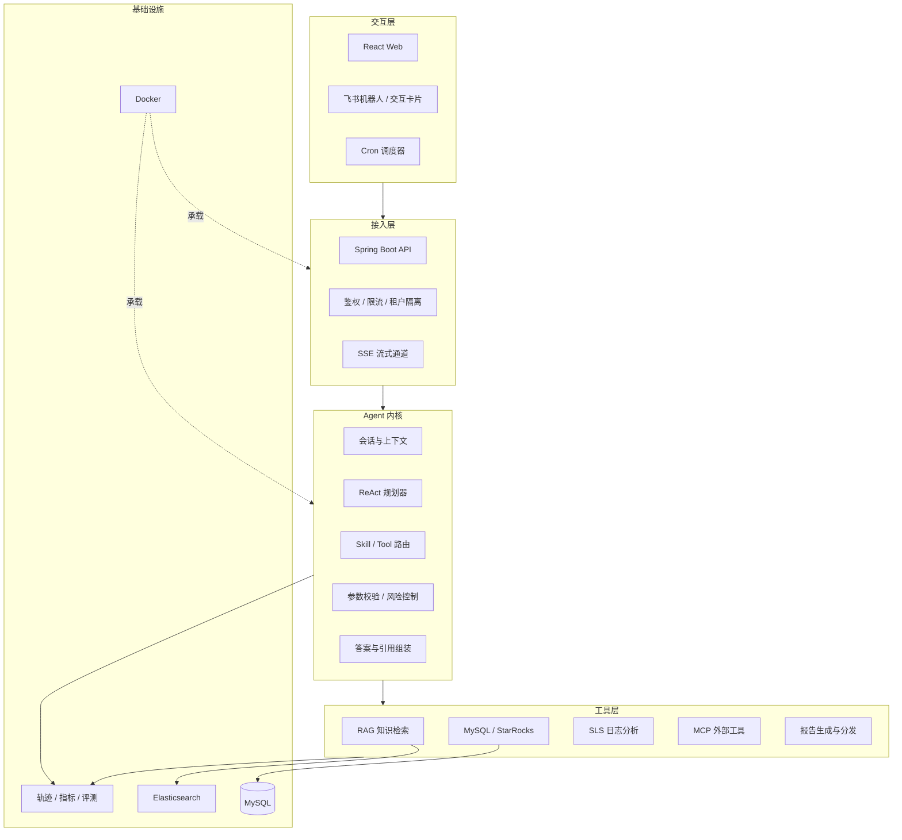

# 小 One（One Agent）

> 面向飞书场景的企业数字员工与智能助手：让知识查询、数据分析、故障诊断和报告分发从“给出答案”走向“完成任务”。

[](https://www.java.com/)
[](https://spring.io/projects/spring-boot)
[](https://react.dev/)
[](https://github.com/langchain4j/langchain4j)
[](#开源与贡献)

## 项目状态

> [!IMPORTANT]
> 当前公开仓库仅包含项目说明与业务设计，应用源码、部署文件和可复现实验尚未提交。因此，本文将“项目经历口径”和“公开仓库可验证状态”分开描述；运行方式会在源码开放后补充。

## 为什么做小 One

企业里的信息与动作往往散落在知识库、业务数据库、日志平台、数据仓库和第三方系统中。传统问答机器人只能告诉用户“可能发生了什么”，但真实工作还需要继续查询、分析、确认、执行、通知和复盘。

小 One 以统一的 Web/飞书入口承接请求，通过 Agent 规划和工具调用连接企业系统，并用权限控制、人工确认、任务回执和效果评测把每次请求变成可追踪、可执行、可优化的业务闭环。

### 核心价值

- **一个入口**：统一承接飞书群聊、私聊和 Web 端请求，支持多轮上下文与流式响应。
- **可信回答**：检索企业知识库并附带引用片段；工具结果与模型生成内容分层展示。
- **从问到办**：通过 ReAct / Function Calling 编排多步骤任务，不止回答问题，还能完成查询、诊断、分发与回传。
- **安全可控**：鉴权、白名单、只读 SQL、敏感参数脱敏、最小权限与高风险操作人工确认。
- **持续优化**：记录计划、工具调用、耗时、错误与用户反馈，用评测集驱动提示词、检索和工具路由迭代。

## 典型场景

| 场景 | 用户输入 | Agent 动作 | 最终交付 |
| --- | --- | --- | --- |
| 企业知识问答 | “报销需要哪些材料？” | 意图识别 → 知识检索 → 重排 → 引用组装 | 带来源的答案与相关文档 |
| 经营数据分析 | “本周华东区转化为什么下降？” | 指标解析 → 只读查询 → 同比/环比 → 归因分析 | 结论、数据依据与后续建议 |
| 故障诊断 | “支付成功率突然下降，帮我排查” | 指标查询 → 日志检索 → 依赖检查 → 假设验证 | 根因候选、证据链与处置建议 |
| 长报告分发 | “把月报发给管理群” | 生成 → 摘要 → 正文分段 → 飞书发送 → 回执确认 | 可读摘要、完整正文与发送状态 |
| 周期巡检 | Cron 触发 | 拉取指标 → 规则/模型分析 → 生成报告 → 定向通知 | 巡检报告、告警与跟进任务 |

## 业务闭环



闭环的关键不在于“模型生成了一段话”，而在于每个请求都有明确的输入、证据、动作、结果和反馈：

1. **理解**：识别用户、租户、会话和真实意图，补齐缺失参数。
2. **规划**：将目标拆成可执行步骤，选择 Skill 和工具，标记风险等级。
3. **执行**：并行调用无依赖工具；对有依赖步骤按 DAG 顺序执行，并处理超时、重试和降级。
4. **校验**：检查工具返回、引用覆盖率和结论一致性；高风险动作必须由用户确认。
5. **交付**：通过 SSE、飞书卡片或群消息返回摘要、证据、正文及任务状态。
6. **回传**：采集发送回执、用户追问、赞踩和人工修正，关联到本次任务轨迹。
7. **优化**：将失败样例沉淀为评测集，持续优化检索、提示词、工具描述和路由策略。

更完整的状态机、异常补偿、数据模型与验收指标见 [业务闭环设计](docs/business-closed-loop.md)。

## 系统架构



## Agent 执行机制

### Skill 与 Tool 分层

- **Skill**：封装稳定的业务流程，例如“故障诊断”“周报生成”“知识问答”，负责步骤编排、输入输出约束和失败补偿。
- **Tool**：提供原子能力，例如 `search_knowledge`、`query_metrics`、`search_logs`、`send_feishu_message`。
- **MCP**：统一外部工具接入协议，让新增系统只需注册工具能力，不修改 Agent 核心推理流程。

### 一次任务的执行轨迹

```text
RECEIVED → AUTHORIZED → PLANNING → EXECUTING → VERIFYING
         → WAITING_CONFIRMATION（可选）→ DELIVERING → SUCCEEDED
                                      ↘ FAILED / PARTIAL_SUCCESS
```

每一步保存 `traceId`、输入摘要、工具参数摘要、耗时、结果状态和错误类型。这样既能定位“为什么答错”，也能区分模型、检索、数据源和外部接口故障。

### 工具调用约束

| 能力 | 关键约束 | 失败策略 |
| --- | --- | --- |
| 知识检索 | 租户过滤、文档权限、引用片段必填 | 降低回答确定性并提示补充资料 |
| SQL 查询 | 只读账号、AST 校验、表白名单、行数/耗时上限 | 终止危险查询，返回安全错误码 |
| 日志检索 | 时间窗限制、字段脱敏、查询频控 | 缩小查询范围或返回诊断缺口 |
| 外部动作 | 参数 Schema 校验、幂等键、风险分级 | 重试、补偿或转人工确认 |
| 消息分发 | 长文本分段、摘要优先、频率限制 | 记录分段回执并重发失败片段 |

## 知识问答设计

1. 对问题做改写和实体补全，同时保留原问题用于审计。
2. 按租户、部门和文档权限过滤候选文档。
3. 使用 Elasticsearch 进行关键词/向量混合检索并重排。
4. 将引用片段、结构化数据和工具结果分别注入上下文。
5. 生成答案后检查引用覆盖与结论一致性；证据不足时明确说明。
6. 保存用户反馈和纠错内容，进入离线评测与知识更新队列。

## 安全与权限

- 用户、租户、角色和资源四级授权，检索与工具调用使用同一权限上下文。
- 数据库工具使用最小权限只读账号，并限制数据库、表、字段、行数和执行时间。
- 手机号、证件号、密钥等敏感字段在进入模型或日志前脱敏。
- 对发送消息、写入业务系统等操作生成幂等键；中高风险操作进入确认节点。
- 全链路审计：谁在何时提出请求、模型做了什么计划、调用了哪些工具、最终影响了什么资源。

## 技术栈

| 模块 | 技术选型 |
| --- | --- |
| 前端 | React、SSE、飞书交互卡片 |
| 后端 | Java、Spring Boot |
| Agent | DeepSeek、LangChain4j、ReAct、Function Calling、Skill |
| 工具协议 | MCP |
| 数据与检索 | MySQL、StarRocks、Elasticsearch、SLS |
| 调度与部署 | Cron、Docker |
| 可观测性 | Trace、结构化日志、业务指标、离线评测集 |

## 项目经历指标

以下数据来自简历中的项目经历口径，待源码、评测脚本和样本集开放后补充可复现说明：

| 指标 | 结果 | 建议公开的复现材料 |
| --- | ---: | --- |
| 30+ 评测任务工具调用成功率 | 92% | 测试集版本、成功判定规则、逐项结果 |
| 跨系统人工查询平均耗时 | 15 分钟 → 3 分钟内 | 样本范围、起止计时口径、P50/P95 |
| 新场景接入成本 | 无需修改 Agent 核心代码 | Skill/Tool 注册示例与集成测试 |

## 规划中的仓库结构

```text
one-agent/
├── apps/
│   ├── server/                 # Spring Boot API 与 Agent 内核
│   └── web/                    # React 管理台与对话界面
├── modules/
│   ├── agent-core/             # 规划、上下文、路由与结果组装
│   ├── skill-runtime/          # Skill 生命周期与流程编排
│   ├── tool-adapters/          # RAG、SQL、SLS、飞书等适配器
│   └── observability/          # Trace、指标与评测数据
├── deploy/                     # Docker Compose 与环境配置示例
├── evals/                      # 评测集、运行脚本与结果报告
└── docs/
    └── business-closed-loop.md # 业务闭环详细设计
```

## Roadmap

- [x] 项目定位与端到端业务闭环设计
- [x] 权限、安全、异常补偿和评测口径设计
- [ ] 提交最小可运行后端与 Web 对话界面
- [ ] 提交知识检索、只读 SQL、SLS 与飞书工具适配器
- [ ] 提交 Docker Compose 一键启动环境
- [ ] 开放脱敏后的 30+ 场景评测集与报告
- [ ] 补充演示视频、架构决策记录与线上指标看板

## 开源与贡献

项目暂未声明开源许可证。在许可证明确前，请勿默认复制、分发或商用仓库内容。Issue、贡献规范和代码风格将在源码开放时一并补充。
