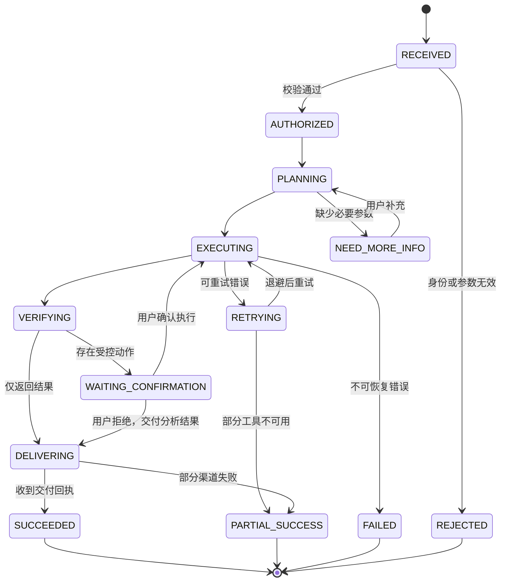

# 小 One 业务闭环设计

本文描述小 One 如何把企业知识问答、经营分析、故障诊断和报告分发统一为一套可执行、可追踪、可补偿、可评测的业务系统。

## 1. 设计目标

### 1.1 业务目标

- 缩短跨知识库、数据库、日志系统和业务平台的人工查询路径。
- 将“发现问题—分析问题—给出处置—执行/通知—结果确认”串成闭环。
- 用 Skill 固化高频流程，让业务扩展不依赖修改 Agent 核心代码。
- 让每次回答和动作都可追溯、可解释，并满足企业权限与审计要求。

### 1.2 非目标

- 不允许模型绕过权限直接访问数据源。
- 不把无证据的模型推断包装成事实。
- 不默认自动执行写入、删除、对外发送等高风险动作。
- 不用单一“回答正确率”掩盖检索、工具、数据源和交付链路的问题。

## 2. 角色与边界

| 角色 | 职责 | 典型权限 |
| --- | --- | --- |
| 普通员工 | 提问、查询本人可见信息、反馈结果 | 知识检索、有限只读工具 |
| 业务负责人 | 查看部门指标、接收报告、确认业务动作 | 部门数据、报告分发、审批确认 |
| 运维/研发 | 发起诊断、查看日志和依赖状态 | 脱敏日志、监控指标、诊断工具 |
| 管理员 | 配置数据源、工具、权限和评测集 | 管理面能力，不参与日常问答 |
| 系统调度器 | 按计划触发巡检和报告任务 | 仅能执行绑定的 Service Account 能力 |

系统边界包含 Agent 编排、企业数据只读访问、报告生成与飞书交付；真实业务写操作通过受控工具完成，必须具备幂等、审计和必要的人工确认。

## 3. 统一任务模型

所有入口统一转成 `Task`，避免 Web、飞书和 Cron 各自维护一套业务逻辑。

```json
{
  "taskId": "tsk_xxx",
  "traceId": "trc_xxx",
  "source": "FEISHU | WEB | CRON",
  "tenantId": "tenant_xxx",
  "operator": {
    "userId": "user_xxx",
    "roles": ["OPS"]
  },
  "goal": "排查最近 30 分钟支付成功率下降原因",
  "context": {
    "conversationId": "conv_xxx",
    "timeRange": ["start", "end"]
  },
  "riskLevel": "READ_ONLY",
  "status": "RECEIVED"
}
```

### 3.1 状态机



终态必须写入任务结果和错误分类；不能因为 SSE 断开就丢失后台任务状态，也不能因为消息已发送就假设用户已收到。

## 4. 四条核心业务闭环

### 4.1 知识问答闭环

```text
问题 → 权限过滤 → 查询改写 → 混合检索 → 重排 → 生成带引用答案
    → 用户反馈/追问 → 错例入评测集 → 知识或检索策略更新 → 回归评测
```

关键规则：

- 检索前注入租户、部门、文档 ACL，禁止“先检索后过滤”。
- 回答中的关键事实必须能映射到引用片段；没有证据时返回“未找到可靠依据”。
- 文档版本、更新时间和来源随引用保存，方便处理过期知识。
- 负反馈按“知识缺失、召回失败、排序错误、生成错误、权限错误”分类，而不是只记录赞踩。

### 4.2 经营分析闭环

```text
业务问题 → 指标/维度解析 → 口径确认 → 只读查询 → 同比/环比/分群
        → 结论与数据证据 → 建议动作 → 负责人确认 → 跟踪指标变化 → 复盘
```

关键规则：

- 指标必须绑定业务口径、数据源和更新时间，避免同名指标含义不一致。
- SQL 先经过 AST 检查，再施加表/字段白名单、时间窗、行数和超时限制。
- 分析结论区分“数据事实”“相关性推断”和“待验证假设”。
- 建议动作记录负责人和复查时间；后续任务读取结果指标，形成真正的行动闭环。

### 4.3 故障诊断闭环

```text
告警/提问 → 明确影响面 → 查询核心指标 → 检索异常日志 → 检查依赖变化
          → 根因候选排序 → 处置建议 → 人工确认/执行 → 指标回落验证 → 复盘沉淀
```

建议的诊断 Skill：

1. `resolve_scope`：确认服务、环境、时间窗和影响指标。
2. `query_metrics`：拉取基线、当前值和同周期对比。
3. `search_logs`：按 trace、错误码和版本聚合异常日志。
4. `inspect_dependencies`：检查上下游、发布记录和配置变更。
5. `rank_hypotheses`：根据多源证据对根因候选排序。
6. `propose_actions`：给出处置、风险和回滚条件。
7. `verify_recovery`：处置后重新拉取指标，判断是否恢复。
8. `write_postmortem_draft`：将轨迹转成复盘初稿并进入知识库审核流程。

若任何关键数据源不可用，结果必须标记 `PARTIAL_SUCCESS` 并列出诊断盲区，不得输出确定性根因。

### 4.4 巡检与报告闭环

```text
Cron → 读取任务模板与权限快照 → 拉取数据 → 生成报告 → 质量检查
     → 摘要/正文分段 → 飞书分发 → 回执确认 → 追问处理 → 异常生成跟进任务
```

为防止“生成即完成”的伪闭环，报告任务需要记录三类状态：

- `generationStatus`：数据是否完整、报告是否成功生成。
- `deliveryStatus`：每个目标群/用户的分段消息是否送达。
- `followUpStatus`：异常是否创建跟进项、是否被负责人认领、是否到期复查。

## 5. Agent 规划与工具执行

### 5.1 规划输出

规划器不直接返回自然语言，而是先产生受约束的计划：

```json
{
  "intent": "INCIDENT_DIAGNOSIS",
  "requiredInputs": ["service", "environment", "timeRange"],
  "steps": [
    {"id": "s1", "tool": "query_metrics", "dependsOn": []},
    {"id": "s2", "tool": "search_logs", "dependsOn": []},
    {"id": "s3", "tool": "rank_hypotheses", "dependsOn": ["s1", "s2"]}
  ],
  "riskLevel": "READ_ONLY",
  "successCriteria": ["获得指标变化", "至少一条可验证证据"]
}
```

执行器基于依赖关系并发运行 `s1`、`s2`，待结果齐备后运行 `s3`。计划中不存在的工具不能被临时调用，除非重新规划并再次通过权限检查。

### 5.2 Tool Contract

每个工具至少声明：

- 名称、版本、用途和禁用场景；
- JSON Schema 输入/输出；
- 所需角色、资源范围和风险等级；
- 超时、重试、限流和幂等策略；
- 错误码与可观测字段；
- 是否允许并行、是否需要人工确认。

### 5.3 超时、重试和降级

| 错误类型 | 示例 | 策略 |
| --- | --- | --- |
| 瞬时错误 | 连接重置、429、临时 5xx | 指数退避 + 抖动，限制重试次数 |
| 参数错误 | 缺少时间窗、字段格式错误 | 不重试，要求补充或重新规划 |
| 权限错误 | 无文档/数据表权限 | 不降权、不绕过，返回可解释拒绝 |
| 数据不完整 | 日志延迟、部分指标缺失 | 标记部分成功，披露盲区 |
| 交付失败 | 某一消息分段发送失败 | 按分段幂等键补发，不重复发送成功片段 |
| 模型失败 | 超时、格式不合法 | 结构化重试；仍失败则用模板化结果降级 |

## 6. 数据模型

### 6.1 核心实体

| 实体 | 关键字段 | 用途 |
| --- | --- | --- |
| `conversation` | tenant、channel、participants、summary | 管理多轮上下文 |
| `task` | goal、source、risk、status、owner | 统一承接请求和调度任务 |
| `execution_step` | plan、tool、inputDigest、status、latency | 保存可回放执行轨迹 |
| `evidence` | source、uri、version、snippet、permission | 支撑引用与诊断证据链 |
| `action` | type、risk、idempotencyKey、approval | 管理受控外部动作 |
| `delivery` | channel、recipient、segment、receipt | 跟踪消息与报告交付 |
| `feedback` | rating、category、correction | 连接线上结果和评测优化 |
| `evaluation_case` | input、expected、datasetVersion | 固化回归测试样本 |

### 6.2 数据留存原则

- 原始敏感数据尽量不进入模型轨迹，只保存脱敏摘要或受控引用。
- 会话、工具参数、证据和交付回执分别设置留存周期。
- 删除用户/租户数据时同步清理索引、缓存、轨迹和评测副本。
- 评测样本进入数据集前必须脱敏，并保留来源与授权记录。

## 7. 接口与事件建议

### 7.1 同步入口

```http
POST /api/v1/tasks
GET  /api/v1/tasks/{taskId}
POST /api/v1/tasks/{taskId}/confirm
POST /api/v1/tasks/{taskId}/feedback
GET  /api/v1/conversations/{conversationId}/events
```

`events` 使用 SSE 推送结构化事件，而不是只传文本：

```text
task.accepted
plan.created
tool.started
tool.completed
answer.delta
confirmation.required
delivery.completed
task.completed
task.failed
```

### 7.2 内部领域事件

- `TaskCreated`：入口完成身份与基础参数校验。
- `ActionApprovalRequested`：高风险动作等待确认。
- `TaskSucceeded/TaskFailed`：触发指标、通知和补偿逻辑。
- `ReportDeliveryFailed`：进入补发队列或通知管理员。
- `NegativeFeedbackReceived`：生成待标注样本。
- `EvaluationRegressionDetected`：阻断有明显回退的发布。

## 8. 权限与风险控制

### 8.1 风险等级

| 级别 | 示例 | 执行策略 |
| --- | --- | --- |
| `READ_ONLY` | 检索知识、查询指标 | 权限通过后自动执行 |
| `LOW_WRITE` | 创建个人草稿、保存筛选条件 | 明示动作，可撤销 |
| `CONTROLLED_WRITE` | 群发消息、创建工单、修改业务状态 | 展示参数并等待人工确认 |
| `PROHIBITED` | 删除核心数据、绕过审批、访问未授权租户 | 工具层直接拒绝 |

### 8.2 防护顺序

```text
入口身份 → 租户隔离 → RBAC/ABAC → Tool 权限 → 参数 Schema
        → 业务白名单 → 风险确认 → 幂等执行 → 审计落库
```

权限检查必须发生在工具执行前，并使用服务端可信上下文；不能信任模型生成的 `tenantId`、角色或资源范围。

## 9. 可观测与评测闭环

### 9.1 线上指标

- 任务成功率、部分成功率、失败率和人工接管率；
- 首字延迟、任务总耗时、工具 P50/P95、超时与重试次数；
- 引用覆盖率、无证据回答率、SQL 拒绝率；
- 报告生成成功率、分段送达率和异常认领率；
- 单任务模型 Token、工具调用和基础设施成本。

### 9.2 离线评测

评测集按场景、难度、权限和风险分层，至少包含：

- 意图与参数抽取准确性；
- Tool 选择、参数和执行顺序；
- RAG 召回、排序和引用正确性；
- 数据结论与证据一致性；
- 拒答、权限与高风险确认行为；
- 超时、空结果和部分失败下的降级表现。

一次线上失败进入评测闭环的路径：

```text
失败轨迹 → 脱敏 → 人工分类/标注 → 加入版本化评测集
        → 修复检索/Tool/Prompt/代码 → 回归 → 灰度 → 线上指标验证
```

## 10. 验收标准

### 10.1 功能验收

- Web 与飞书请求可生成同一种 `Task`，并通过 `taskId/traceId` 查询状态。
- 至少完成知识问答、数据查询、故障诊断、报告分发四类 Skill 的端到端演示。
- 高风险动作未确认时无法执行；重复确认不会造成重复写入或重复发送。
- SSE 断开重连后可恢复任务进度，后台任务不随连接丢失。
- 部分工具失败时明确列出缺失证据，并返回 `PARTIAL_SUCCESS`。

### 10.2 安全验收

- 跨租户检索和查询测试全部拒绝。
- 非白名单表、写 SQL、超行数和超时查询全部被工具层阻断。
- 日志、提示词、轨迹和评测样本中不出现未脱敏敏感字段。
- 每个外部动作均可追溯到用户、计划、确认记录和执行回执。

### 10.3 效果验收

简历中的“30+ 评测任务工具调用成功率 92%”应按以下口径复现：

```text
工具调用成功率 = 完成正确工具选择、合法参数生成且获得有效结果的任务数
                / 所有需要工具调用的评测任务数
```

同时公开数据集版本、任务明细、失败分类、运行时间和模型/提示词版本。跨系统查询耗时则同时报告人工基线与 Agent 的 P50/P95，避免只展示最好结果。

## 11. 分阶段落地

1. **MVP**：统一 Task、SSE、知识问答、一个只读数据工具、轨迹和基础权限。
2. **业务闭环**：故障诊断、报告分发、确认节点、回执和异常补偿。
3. **平台化**：Skill/Tool 注册中心、MCP 接入、租户级配置和评测流水线。
4. **生产化**：灰度发布、成本治理、容量压测、安全审计与灾备演练。

每一阶段都必须能独立演示并通过对应验收，避免在基础权限和可观测尚未完善时过早扩大自动执行范围。
